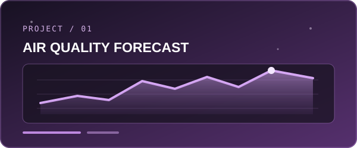
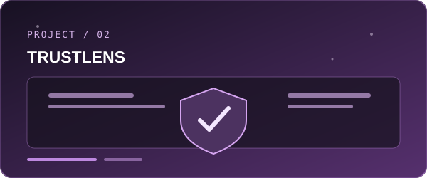

 

<a href="mailto:azhar07kh@gmail.com">Email</a>
&nbsp; · &nbsp;
<a href="https://github.com/azhar07kh-design">GitHub</a>

---

## About Me

I’m **Md Azhar Khan**. My GitHub work spans practical machine learning and web security, from forecasting air quality to checking suspicious links and scam messages.

On **TrustLens**, I contributed security checks for lookalike domains, domain age, threat intelligence feeds, and security headers. I also worked on scam-message analysis using scam-pattern rules, sample data, and AI classification.

My air-quality forecasting work compares machine-learning models to predict next-day air quality for Indian cities. It includes an interactive dashboard for exploring pollutant readings and forecasts.

## Tech Stack

### Languages

  

### Frameworks and tools

  

## Featured Projects

<table>
<tr>
<td width="50%" valign="top">

### [Air Quality Forecasting & Early Warning System](https://github.com/MdAsif678/Air-Forecast-Model)

Predicts whether the next day’s air quality will be unhealthy and estimates the next-day AQI for Indian cities. The project compares several classification models and includes a FastAPI dashboard.

**Random Forest:** F1 0.9140 · AQI regression RMSE 32.96

</td>
<td width="50%" valign="top">

### [TrustLens · Team Breaking Bugs](https://github.com/MdAsif678/Hackmatrix_Breaking_Bugs)

A web security project for checking links, websites, and scam messages. TrustLens gathers security evidence, explains its verdict, and can seal a report on Ethereum Sepolia.

**My contributions:** domain checks · threat-intelligence feeds · security headers · scam-message analysis

</td>
</tr>
</table>

## GitHub Activity

  
  

---
